# Better SOLAR for PC

**v2.3.2** - A local-first FEU Alabang SOLAR companion for desktop Chrome/Edge. View academic records, connect your Canvas calendar, and plan or export a weekly schedule. Also available for mobile versions (ios/android) (see mobile build release).

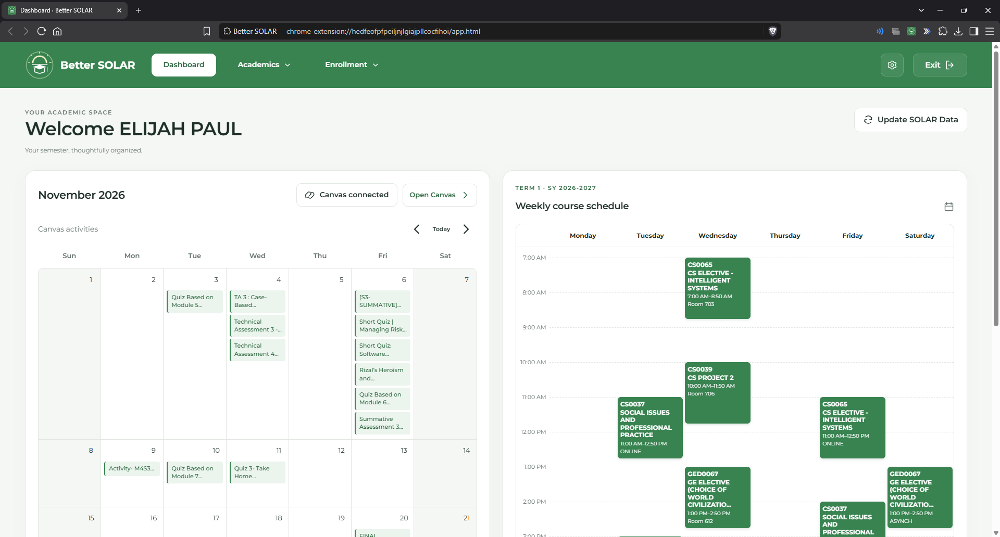

_A first look at the Better SOLAR dashboard._

## Features

- Cached profile, curriculum, grades, assessments, balances, offerings, and enrollment reminders.
- Schedule Creator with individual/block additions, overlapping meetings, and full course details.
- PNG export with a full-screen preview, resizable width, light/dark mode, custom block color, full titles, and editable titles.
- Canvas calendar, themes, collection reports, external-link confirmations, and desktop/mobile JSON transfer.

## Showcase

### Academic records

Review your profile, curriculum, and grades in dedicated views.

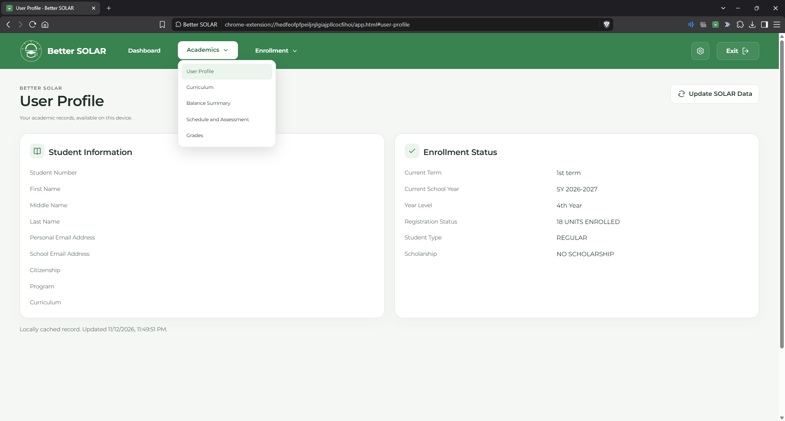

_Profile — view cached student information._

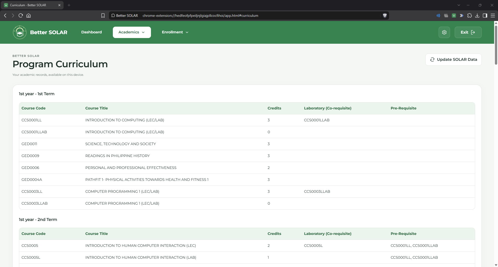

_Curriculum — browse your academic curriculum._

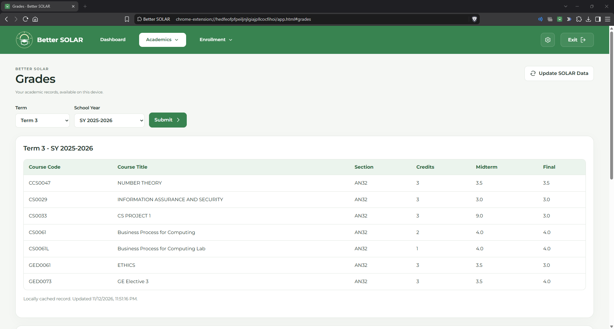

_Grades — review cached academic results._

### Schedule, assessment, and balances

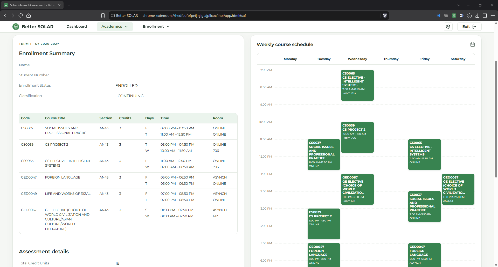

_Schedule and assessment — review your schedule and assessment information._

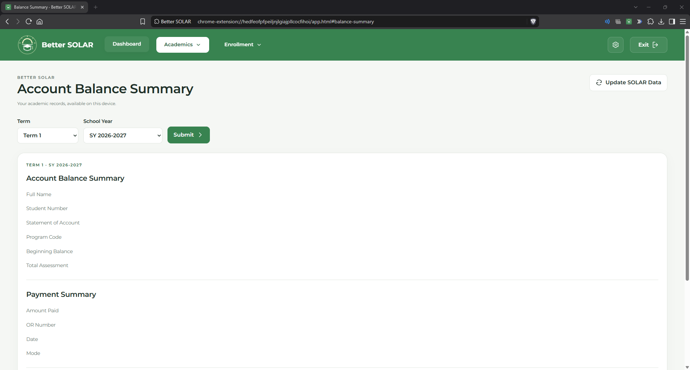

_Account balance summary — review cached balance information._

### Course offerings and enrollment planning

Explore offerings and compare the enrollment view before and after adding content to the schedule visualizer. Planning does not register courses.

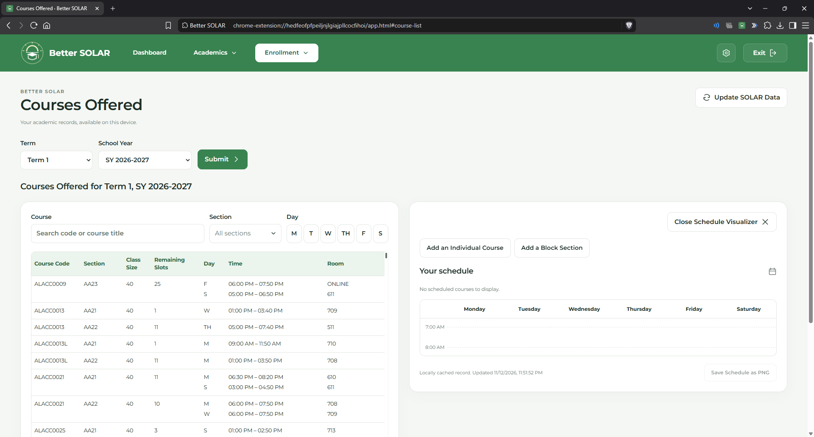

_Courses offered — browse available course offerings._

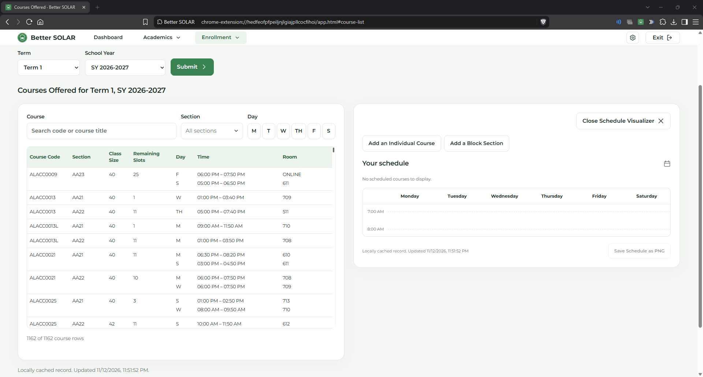

_Enrollment — the schedule visualizer before content is added._

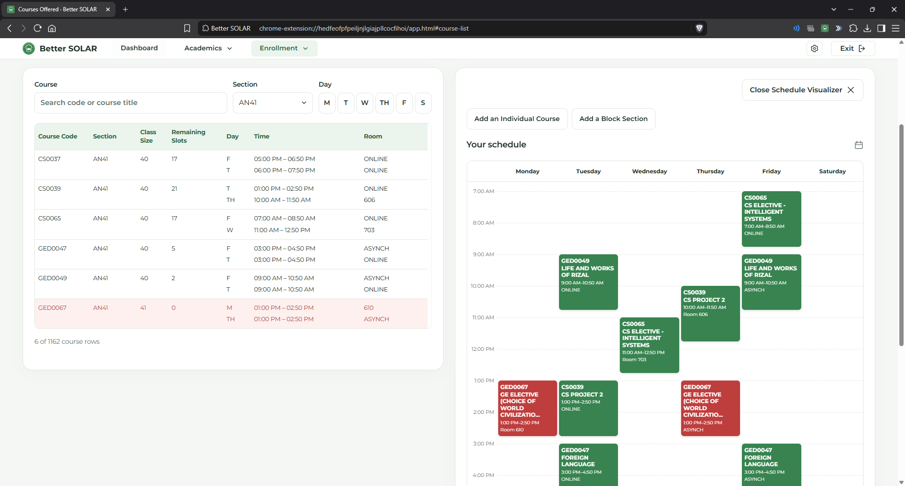

_Enrollment — the schedule visualizer with planning content added._

### Schedule export

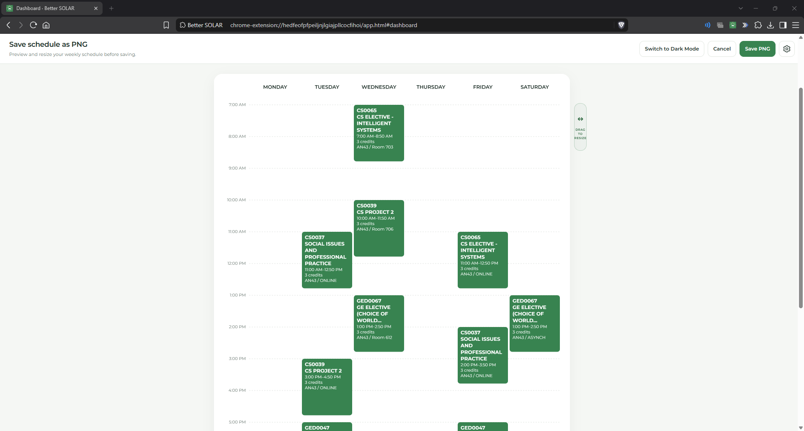

_Save Schedule as PNG — preview your schedule for image export._

### Dark mode

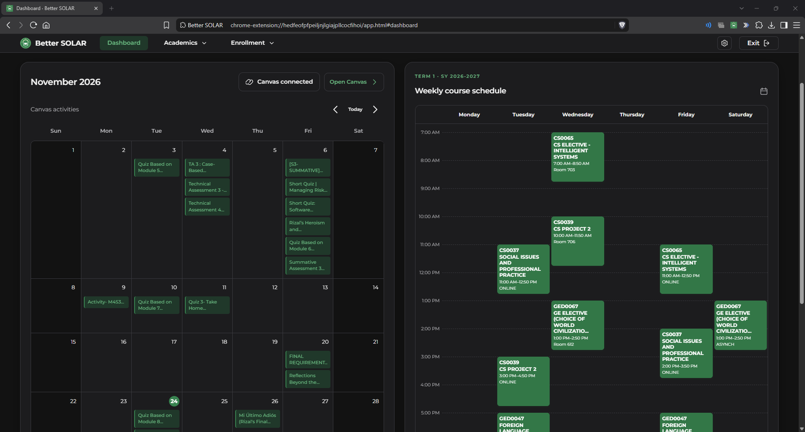

_The dashboard in dark mode._

## Installation

1. Extract this ZIP into a permanent folder.
2. Open your browser's Extensions page and enable Developer mode.
3. Choose **Load unpacked**, then select the extracted folder containing `manifest.json`.
4. Enable Better SOLAR, open its 440 px toolbar popup, and choose **Launch Application** to open a tab in the existing browser window.

### Update without losing cached records

Replace the files in the **same installed folder**, then Reload the existing extension. Do not uninstall it to update. Reload any open SOLAR pages afterward.

## Usage

Sign in to SOLAR in the same browser profile, then choose **Scrape Data** or **Update SOLAR Data**. Expand the collection report to review failures and use **Retry failed work** when needed.

Select a term and school year on academic pages before submitting. For planning, open **Enrollment → Courses Offered → Schedule Creator**. This does not register courses.

Use **Save Schedule as PNG** at the bottom right of any weekly schedule, alongside its update timestamp. Mobile shortens the status to Updated. Resize with the handle or slider (850 px minimum layout width). The gear opens color/title settings with switches; curriculum titles are enabled by default. Custom title fields appear only when the curriculum-title switch is off. Choose **Save PNG**, add an optional label (or leave it blank), and confirm **Save PNG** to open the browser’s Save As dialog and choose the destination folder and filename. The PC package uses the downloads permission; it never opens the mobile share sheet. Each image includes a faint current-year Gryymme watermark. Image edits leave academic records unchanged. Export code/title text stays at 12 px and time/room text at 10 px, including overlaps. Wide shared blocks retain a one-line code and one title line; full-title mode displays complete titles. Time lines cover the actual scheduled hours, rounded to hour boundaries.

To move records to mobile, use **Settings → Transfer academic data → Export scraped data**, send the JSON privately, and import it in the mobile extension. Canvas export can include cached events without the private feed URL.

## Release notes

See [RELEASE_NOTES.md](RELEASE_NOTES.md) for PC v2.3.2 changes and update notes.

## Data and compatibility

Records live in IndexedDB (`better-solar-local`) in your browser profile, not this folder. This ZIP includes no personal records, mobile build, nested archives, tests, or build tools. Exported JSON/PNG files can contain personal data; keep them out of public repositories.

Use Settings to delete scraped data before uninstalling. Deletion does not affect SOLAR/Canvas accounts or files already downloaded. Fonts are cached on the first online launch unless bundled; the SIL font license is included. Live portal compatibility depends on the current SOLAR pages and your signed-in session.

Created by Gryymme (Elijah Miranda Nonan). Independent student project, not an official FEU/SOLAR/Canvas product.
